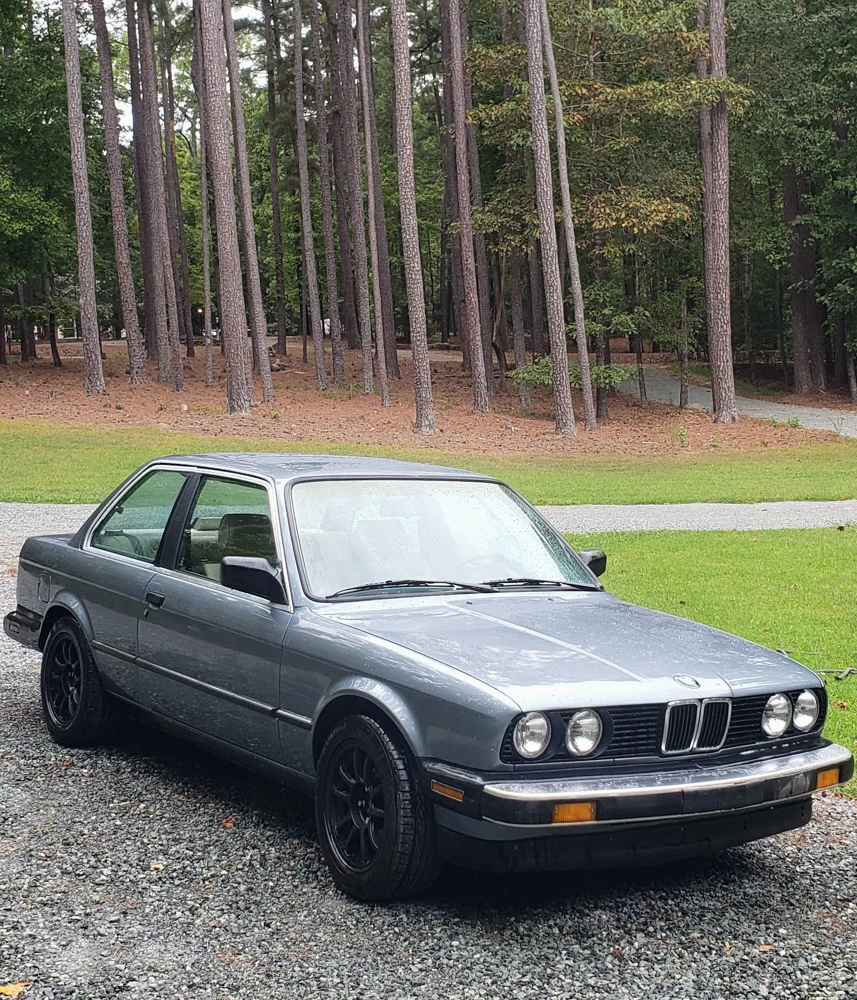

Classic car owners have to be slightly masochistic. Searching for parts, even with current luxuries like the Internet, is always a painful process. As an E30 owner, this issue is compounded by the scarcity of reproduction parts, including body panels and trim. My most recent project was to replace the bumpers on my E30 with something more streamlined than the factory delivered in 1987. It was quite a journey.

## The Ugly

I have an early-model (non-facelift) E30, which features some of the ugliest bumpers possible. They extend from the body on shocks to, presumably, absorb the impact of a low-speed collision. This has always stood out as one of the uglier parts of this car to me.

## The Fix (and a compromise)

Late-model E30s and European variants have much more appealing bumpers. As much as I would love to update to the late-model, modern plastic bumpers, I chose a different route for this project. I have been drawn to the early-model European E30 bumpers and have wanted to put them on my own car for a couple of years. It turns out that I waited too long, and the price of new or used bumpers in good shape has surpassed what I spent on my car. Luckily, I found another option that seemed reasonable.

Instead of rolling the dice on used Euro bumpers or paying $3,500+ for new ones, I decided to go with a middle ground. A company out of Latvia called [Classic Euro Parts](https://www.classiceuroparts.com/) (CEP) makes a reasonably priced set of composite bumpers called the "Shadowline." These appear to be molded from European bumper forms and are a good compromise on price, aesthetics, and customization.

## The Valance Issue

It turns out custom bumpers aren't readily available, and CEP makes them to order. Eventually, I received the bumpers and started test-fitting them, only to realize that the early-model US front valance looks horrible with them. To do this right, a European valance is needed; otherwise, there are some unsightly gaps under the bumper that the previous bumpers covered.

The solution is easy: order a European valance, too. Of course, this isn't the direction I went. Euro valances, especially the Type 2 variant that would fit my car, are no longer available from CEP. The used market was abysmal, too, with sellers demanding hundreds of dollars for some rather ragged used pieces.

This was the excuse I needed to do some custom fabrication. The biggest issues with pairing the US valance with Euro-style bumpers are the gaps under the lower edge of the bumper and the holes where the US bumper trim attached. Filling the holes and creating a patch panel for the gap seemed like a great project to gain some new fabrication skills.

## The Result

The final result turned out a bit better than I expected, although there are more changes I want to make. The valance no longer looks out of place with the CEP Shadowline bumper, and it has the more modern style I was looking for. I suspect I will modify it further by adding some fog-light recesses and removing the tow hooks, but for now I'm satisfied with the results.
